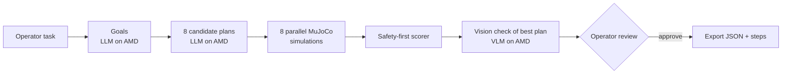

# SimToReal Agent

**Test before you touch.** An operator types a task in plain English. AI on AMD writes eight robot programs, each one is tested in a physics simulation, unsafe ones are rejected with a reason, and a person approves the best one before anything is exported for the real robot.

Built for the **AMD Developer Hackathon: ACT III**, Track 1 (Intelligent Industry), by team Visionary Creators.

## The problem

Re-programming a robot cell for a new pick-and-place job is slow and risky. A program that works on paper can still drop a part, hit the table or reach for something out of range, and on a real line that means scrapped parts, damaged tooling and downtime. AI can write robot programs in seconds, but nobody should run an untested AI program on a real machine.

**Who it is for:** the cell operator or automation engineer who changes what a robot cell does, and who must sign off that a new program is safe.

## What it does

1. **Understand the task.** "Sort both parts by color" becomes explicit goals such as `{"red_part": "bin_a", "blue_part": "bin_b"}`.
2. **Write eight candidate programs** with an LLM on **AMD Token Factory**, each with a different style and temperature. Every step is checked against the allowed actions and objects; broken programs are retried, then dropped.
3. **Test all eight in parallel** in a MuJoCo simulation of a Franka Panda arm. Each run records a video, a final camera image, timings, collisions and dropped parts.
4. **Score safely.** Programs that collide, drop a part, fail a step or miss the goal are rejected with a plain reason. Safe programs are ranked out of 100 (60 for success, up to 20 for speed, up to 20 for fewer steps).
5. **Second opinion from vision.** A vision model on AMD looks at the best program's final camera image. If it disagrees with the simulator or cannot tell, the plan is flagged **needs human review**.
6. **Human approval.** The operator watches the video, acknowledges any review flag and approves. Only then are the program (JSON) and readable steps exported. Nothing ever commands a real robot.



## Where AMD is used

All model inference runs on **AMD Token Factory**, the AMD GPU service provided for ACT III:

| Job | Model | Setting |
| --- | --- | --- |
| Read the task and write 8 plans | `DeepSeek-V4-Flash` | `LLM_MODEL` |
| Check the final camera image | `DeepSeek-V4.1-Flash` | `VLM_MODEL` |

Every run shows an **AMD run metrics** panel with the models, planning time, vision time, simulation time, total time and plans per second, all taken from that run. Token Factory is a shared service and does not report the GPU model, so the panel says so instead of guessing. Physics simulation runs on the CPU of the machine hosting the app.

## Results

Live runs on AMD Token Factory, 16 October 2026 (single runs, client-side wall time including network; details in [docs/benchmarks.md](docs/benchmarks.md)):

| Task | Valid plans | Passed simulation | Rejected before reaching a robot | Planning | Total |
| --- | --- | --- | --- | --- | --- |
| Put the red part in bin A | 8 / 8 | 6 | 2 (dropped part) | 5.7 s | 20.6 s |
| Sort both parts by color | 8 / 8 | 6 | 2 (dropped part) | 8.1 s | 115.5 s |
| Blue part out of reach | 8 / 8 | 0 | 8 (unreachable), so nothing is approvable | 6.2 s | 9.8 s |

Across 24 AI-written programs, **12 unsafe or impossible ones were caught in simulation**, each with a reason the operator can read. For the impossible task, the system refuses to offer any program instead of guessing. In both successful tasks the vision check disagreed because the arm hides the bin in the overhead image, and the app correctly required a human to look before approving.

## Run it

You need an AMD Token Factory API key: sign in at [notebooks.amd.com/tokenfactory](https://notebooks.amd.com/tokenfactory) and create one under **API Keys**. Without a key, the saved-plan demos and tests still work.

### Option A: Docker (one command)

```sh
git clone https://github.com/anish-01/simtoreal-agent.git
cd simtoreal-agent
cp .env.tokenfactory.example .env      # then paste your key after LLM_API_KEY=
docker build -t simtoreal-agent .
docker run --rm -p 7860:7860 --env-file .env simtoreal-agent
```

Open http://localhost:7860. The key is passed at run time and is never copied into the image.

### Option B: Python

Python 3.12 or newer, on macOS or Linux:

```sh
git clone https://github.com/anish-01/simtoreal-agent.git
cd simtoreal-agent
python3 -m venv .venv
.venv/bin/python -m pip install -r requirements-ui.txt
cp .env.tokenfactory.example .env      # then paste your key after LLM_API_KEY=
.venv/bin/python app.py
```

Open http://127.0.0.1:7860, pick **Red to bin A**, **Sort both parts** or **Try an out-of-reach part**, and press **Test 8 plans in simulation**. On macOS, allow graphics access if asked.

### Settings (`.env`)

| Variable | Meaning |
| --- | --- |
| `LLM_BASE_URL` | OpenAI-compatible endpoint for planning (Token Factory: `https://developer.amd.com.cn/radeon/api/v1`) |
| `VLM_BASE_URL` | Endpoint for the vision check (same Token Factory URL) |
| `LLM_API_KEY` | Your Token Factory key, used for both. Keep it only in `.env` |
| `LLM_MODEL`, `VLM_MODEL` | Model IDs; they must exist in the endpoint's `/models` list |
| `GPU_NAME` | Text for the AMD panel; describe the real hardware only |
| `SIM_WORKERS` | Parallel simulations (default: CPU count, at most 8; 4 suits an 8 GB laptop) |
| `GRADIO_SERVER_NAME`, `GRADIO_SERVER_PORT` | Where the page listens (default `127.0.0.1:7860`; Docker uses `0.0.0.0`) |

The shared Token Factory account allows about 20 requests per minute; one eight-plan run uses roughly ten. Wait about a minute between runs.

### Without a key

```sh
.venv/bin/python -m pip install pytest==9.1.1
PYTHON_DOTENV_DISABLED=1 .venv/bin/python -m pytest -q    # 111 tests, no network
SIM_WORKERS=4 .venv/bin/python scripts/demo_tasks.py       # the 3 demos with saved plans
```

`PYTHON_DOTENV_DISABLED=1` keeps tests offline even when `.env` holds a key. Add `--live --demo easy` (or `medium`, `unreachable`) to `scripts/demo_tasks.py` to check one demo against the live models.

## Safety by design

- The app only exports files. It never connects to or commands a real robot.
- Rejected programs can never be selected or exported; approval re-checks the simulation result and the plan format.
- Unknown or disagreeing vision checks need an explicit human acknowledgement.
- Each export records the task, goals, plan, score, simulation evidence, vision result and UTC approval time.
- Keys stay in `.env` (git-ignored and excluded from the Docker image).

## Limitations

- One scene: a Panda arm, two parts and two bins. The controller is tuned to it.
- The simulator measures arm-table collisions and dropped parts; full path collision checking is future work.
- The overhead camera can be blocked by the arm, which is why vision only flags for review and never approves on its own.
- Token Factory does not expose the GPU model or server-side timing, so the numbers above are end-to-end times, not GPU benchmarks.

## Project files

| Path | Purpose |
| --- | --- |
| `app.py` | Gradio operator page: run, review, AMD metrics, approval |
| `pipeline.py` | Task → goals → 8 plans → parallel simulations → scores → vision check |
| `planner.py` | LLM prompts, plan validation and retries |
| `simulator.py`, `actions.py` | MuJoCo execution of a plan with a bounded Panda controller, video and safety measurements |
| `scorer.py` | Safety-first rejection and ranking |
| `verifier.py` | Vision check of the final image and human-review flag |
| `exporter.py` | Approval checks and JSON / readable-step exports |
| `demo_tasks.py`, `scripts/demo_tasks.py` | The three demo tasks, offline and live |
| `scenes/` | Factory scenes and the Panda model from MuJoCo Menagerie (Apache 2.0, see [changes](scenes/panda/LOCAL_CHANGES.md)) |
| `Dockerfile` | Container for the operator page |

More detail: [plan format](docs/plan_format.md), [actions](docs/day1_actions.md), [simulator](docs/day2_simulator.md), [scorer and demos](docs/day3_scorer_demos.md), [operator page](docs/day4_day5_ui.md), [prompt tests](docs/prompt_tests.md), [benchmarks](docs/benchmarks.md), [self-hosting on MI300X with vLLM](docs/amd_setup.md).

## Team

**Visionary Creators**

- Anish Jaiswal ([@anish-01](https://github.com/anish-01)): AI planning, AMD integration, backend.
- Shailesh ([@shaileshkryadav](https://github.com/shaileshkryadav)): robot simulation, operator UI.

Work was tracked on the [project board](https://github.com/users/anish-01/projects/3) and [issues](https://github.com/anish-01/simtoreal-agent/issues).
